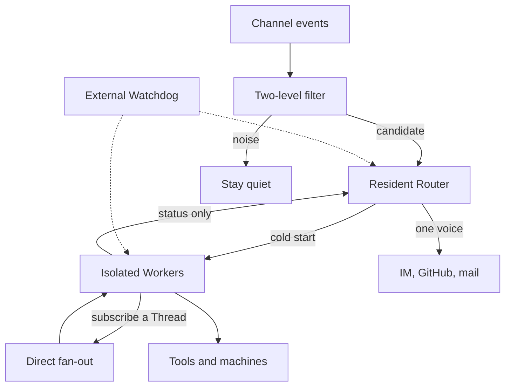

This is a reading, not a translation. Yujia Qiao and the DeepSeek Harness team wrote the architecture. I read it in Guo Qiang's full reprint, [面向工程实践的架构思路探讨：DeepSeek Super-agent 系统架构](https://guobug.github.io/posts/2026/11/01/deepseek-harness-super-agent-architecture/?lang=en), which says the text is reproduced without cuts or added commentary. The essay is an engineering argument, not a product description. The public code, [deepseek-ai/dsh-superagent-prototype](https://github.com/deepseek-ai/dsh-superagent-prototype), is narrower: its README says it was adapted for publication, is not the internal system, and that some designs in the essay are future work. Below, the essay is the architecture and the repository is a prototype.

## What the harness is for

A model with tools can finish a hard task with less step-by-step steering. The essay asks what breaks when that is a whole working day. Work is still a session, and sessions do not share context. The authors say a person can actively follow only about three to five. The ceiling on one task is the model. The ceiling on many tasks is attention.

A connector does not remove the binding. The loop is still synchronous, unrelated tasks still collide in one session, and the agent stops when the laptop sleeps. Their alternative, a Super-agent, keeps context across channels, runs several tasks without mixing them, acts on events, and stays up. They want it continuous, efficient, proactive, and persistent, and they argue one ReAct loop cannot be all four. The chat API glued the product to the context window. That glue is the bottleneck.

## How the design is split

Five mechanisms carry the four properties. The diagram is mine, condensed from their sections 2 through 6.

**Router and workers.** One shared session is continuous and slow, and it mixes unrelated tasks. A new session per event is concurrent and forgetful, and several sessions answering at once is noise. Their split puts a resident Router on human contact, cross-task decisions, and memory, and puts execution in workers that are context-isolated, hold the real tools, and do not speak to the user. Workers report status upward. The Router is the only voice, and they suggest it may not even have a shell. A lighter model can sit on the Router; the worker, because it writes the artifact, wants the strongest model. A worker may itself spawn subagents. The Router does not have to know.

This is not an agent team. A team lead plans inside one task. The Router only dispatches between tasks. Prompting a lead to refuse the work rebuilds the shape by instruction, and they would rather it be structural, because prompts slip.

**Events, then a cache.** The driving input is a Trigger: a chat message, a mail, a review comment, a CI result. Most of that stream is noise, so a large model should not see all of it. Deterministic code filters on source, scope, and allow-lists. Candidates reach a model, which judges them against a policy written as a prompt. After a worker exists, later events on the same Thread — one pull request, one topic, one mail chain — go straight to subscribers. The Router still observes the stream, but it is not on the forwarding path for work it has already assigned. Subscriptions are many-to-many, which is how two workers on one pull request notice each other without a private channel.

The window is then the scarce resource. Their phrase is that wasting it wastes the model's intelligence. Inline keeps the likely-next fact in the window: an id, a short snippet, a neighboring message. Spill leaves the rest outside, with a handle. Done consistently, that is chain of recall: each recalled object inlines the ids of the next hop, so a Router can walk from a message to a thread to a worker to another review without holding every history. I read this as cache policy.

**Asynchrony, channels, machines, watchdog.** A classical tool call blocks until it returns. They want `start()` and `stop()`: the loop hears "started," the result returns later as an event, and a new human message is handled at the next step. They say this asynchronous loop exists in DeepSeek Harness and is not on by default. Worker traces stay inside the worker. On IM they want rare, short messages; one rule they report as useful is a cap of 100 words. On GitHub or mail they want a structured artifact.

A local agent also ties the loop, the log, and the toolchain to one device. They separate them. The loop runs in stateless cloud compute; session state lives in a database; the heavy environment stays put, including a laptop with uncommitted edits, and a small daemon only runs commands and returns results. They compare this to Anthropic's "decoupling the brain from the hands," and they note the difference: that discussion is about hosted sandboxes and customer VPCs, while theirs starts from machines that sleep. A separate Watchdog session, woken by a timer, is the external control loop. It is asked not only whether a process is up, but whether a worker is making progress or has drifted. A maintainer can talk to it and change prompts or trigger rules.

The prototype is a smaller dialect of the same split. Its [domain model](https://github.com/deepseek-ai/dsh-superagent-prototype/blob/main/docs/001-domain.md) names a main session as orchestrator and an executor session as worker: Eval is a gate plus a model assessment, an acceptance becomes a Ticket with a Mandate, and an Assignment binds that Ticket to one session and one directory. Subscription fan-out skips Eval. Sources are GitHub and, optionally, Feishu, for one repository. Its [philosophy](https://github.com/deepseek-ai/dsh-superagent-prototype/blob/main/docs/000-philosophy.md) is stricter than a slogan about being proactive: act only when asked or when a written rule allows it, and speak only when a person must act or can use a result.

## What is actually new

Fast and slow paths, speculative execution, separating compute from storage, and an outside watchdog are old systems ideas. The essay says so. What is worth keeping is the composition: the user no longer manages sessions, the coordinator is not allowed to do the work, and a fast path keeps that coordinator off the hot path.

Section 7 is their evidence, and it is preliminary: a synthetic stream of about 300 messages, about 20 of them work requests, coding replaced by a tool that only spends time, five runs each. They report a median of 12.4 minutes and a 95th percentile of 15.7 minutes for the Super-agent. A single session with a subagent tool often just did the work. Under a neutral prompt it never delegated in five runs, and the 95th percentile reached 29.5 minutes. A prompt that preferred delegation helped on four of five runs and still left a long tail. Dropping direct subscription barely changed completion time, but raised Router decisions by about 30 percent and read-cache tokens from 23.23 million to 31.77 million. A separate Router test, workers mocked, moved arrivals from about one trigger a minute to about forty: mean batch 1.0 to 2.8, request time 2.5 to 3.9 seconds, time per decision 6.4 to 1.6 seconds. I have not reproduced this. The point they stress is enough: if delegation is only a suggestion, the model often ignores it.

The costs sit in the same numbers. More sessions buy a stabler schedule and spend more cached tokens. On this load the fast path saves the Router tokens; it does not make the task better. Batching works only while the model can still read a pile of triggers, and they name context length and that accuracy as the ceiling. Sharding the Router, their next step when one session is not enough, spends the global memory the design exists to protect.

The failures follow from the same choices. Shared-thread subscriptions miss a conflict that never becomes an event. Speculative repair saves attention only while the agent stays silent; if it does not, it is noise, which the philosophy doc treats as fatal. The watchdog is another model with tools, so it can misread "no progress," and whoever can reach it can change the system. Section 8.4 refuses a happy ending: a cloud loop plus device daemons assumes mutual trust. Prompt injection or a server compromise then reaches every connected machine, and a credential in context can leak during ordinary use. They want the model to use a credential without seeing it. Until then, they keep the system in a small trusted scope.

## What I would change in training

These are opinions from foundation-model work on video understanding. They are not a claim about what DeepSeek is training.

The harness is a policy, and most agent traces do not contain it. A ReAct log teaches a model to continue. This design also needs it to refuse, dispatch, and stay quiet. If post-training data is only successful tool traces, we keep building the agent that, in their ablation, does not delegate. I would keep the negative decisions: triggers the fast path dropped, tickets ignored, reports not worth showing. Those are the product.

Mid-training is where inline and spill either stick or fight the model. Their Router batch is a long input and a short output, so context length still matters, but the skill is knowing what to leave outside. Chain of recall is not month-scale memory; the essay already says so.

For tool-use reinforcement learning I would not score only task success. The prototype's objective is attention. A fix that also pings a channel three times is a worse policy than a slower run that posts one pull request. The people who pay are outside the rollout, which makes the reward awkward. It is still the objective the system is built around.

The essay's triggers are text. A video or a meeting is not a message with an allow-list. I do not think that retires the two-layer split. It changes the fast path. Code can still drop events by source, but "is this frame worth an expensive model" is a perception problem, so the fast path has to be a cheap model, or a cheap head of the same omni model. I would let the harness speculate on text and on short clips tied to an explicit thread, and require a stronger signal before a full visual pass.

"Workers do not talk" is the rule I expect to break first once agents share video and documents rather than a GitHub thread. The essay already treats direct worker communication as an open choice when coupling rises. I would not add a chat channel by default. I would pass a typed artifact — a clip id, a caption, a mandate — that the Router can inline, so workers share a reference instead of a conversation. That is a preference, and it is inline-and-spill applied to modalities the essay does not discuss.

## What is still open

Their section 8 already asks when to shard the Router, how a person steps in once the session is not the interface, how instances talk across permission boundaries, and how credentials stay out of context. From training, "stay quiet" has no natural label: a miss and a lucky silence look the same. A video stream also has no obvious Thread, so a bad definition either floods workers or hides the event that mattered.

The point I want to keep is narrow. The session is an implementation detail, and a harness that leaves delegation to the model's mood will not get it. Most of the machinery is classical. What should change training is the policy around attention: what the model is allowed to see, when it must be silent, and which of those decisions are worth learning. The public prototype is a place to read that policy. On its authors' own account, it is not the system the essay describes.
